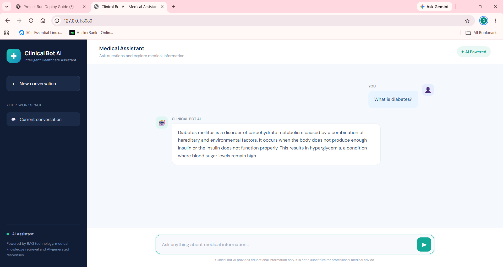

# 🏥 Clinical Bot AI - Medical Question Answering System

An AI-powered medical question-answering chatbot built using Retrieval-Augmented Generation (RAG). It retrieves relevant information from a medical PDF and generates context-based answers using Google Gemini.

## 📌 Project Overview

Clinical Bot AI is designed to answer medical-related questions using information from a medical reference book.

Instead of relying only on the language model's general knowledge, the application retrieves relevant document content from a Pinecone vector database and provides it as context to Gemini.

## 🎯 Objectives

- Build a medical document-based question-answering chatbot.
- Implement Retrieval-Augmented Generation (RAG).
- Extract text from PDF documents.
- Convert document chunks into vector embeddings.
- Store and retrieve embeddings using Pinecone.
- Generate concise answers using Google Gemini.

## ✨ Features

- PDF text extraction using PyMuPDF.
- OCR support for scanned PDF pages using Tesseract.
- Text chunking using RecursiveCharacterTextSplitter.
- Semantic search using Hugging Face embeddings.
- Vector storage and retrieval using Pinecone.
- AI-powered responses using Gemini 3.1 Flash-Lite.
- Web-based chatbot interface.
- Context-based answering to reduce unsupported responses.

## 🛠️ Technology Stack

| Component | Technology |
|---|---|
| Programming Language | Python |
| Frontend | HTML, CSS, JavaScript |
| Backend | Flask |
| LLM | Google Gemini 3.1 Flash-Lite |
| LLM Framework | LangChain |
| Embedding Model | all-MiniLM-L6-v2 |
| Vector Database | Pinecone |
| PDF Processing | PyMuPDF |
| OCR | Tesseract |

## 🏗️ System Architecture

[View System Architecture](docs/architecture.mmd)

## 🔄 RAG Workflow

1. Load the medical PDF document.
2. Extract text using PyMuPDF.
3. Apply OCR to pages without extractable text.
4. Split extracted text into smaller chunks.
5. Generate embeddings using Hugging Face.
6. Store the embeddings in Pinecone.
7. Accept a question from the user.
8. Retrieve the three most relevant chunks.
9. Pass the retrieved context and question to Gemini.
10. Display the generated answer in the chatbot interface.

## 📂 Project Structure

```text
Clinical_BOT_AI_Q&A_Project/
│
├── Data/
│   └── Medical_book.pdf
│
├── src/
│   ├── app.py
│   ├── helper.py
│   ├── prompt.py
│   ├── store_index.py
│   ├── requirements.txt
│   └── setup.py
│
├── templates/
│   └── chat.html
│
├── docs/
│   └── architecture.mmd
│
├── screenshots/
│   └── chatbot.png
│
├── .gitignore
└── README.md
```

## ⚙️ Installation and Setup

### 1. Clone the repository

```bash
git clone YOUR_GITHUB_REPOSITORY_URL
cd Clinical_BOT_AI_Q&A_Project
```

### 2. Create a virtual environment

```bash
python -m venv venv
```

### 3. Activate the environment

Windows:

```bash
venv\Scripts\activate
```

### 4. Install dependencies

```bash
pip install -r src/requirements.txt
```

### 5. Configure environment variables

Create a `.env` file in the project root.

```env
PINECONE_API_KEY=your_pinecone_api_key
GOOGLE_API_KEY=your_google_api_key
```

Never upload your actual API keys to GitHub.

### 6. Prepare the Pinecone index

The application uses a Pinecone index named `medicalbot` with 384-dimensional embeddings.

For a new database, place your permitted medical PDF in the `Data` folder and run:

```bash
python -m src.store_index
```

If the existing index is already populated, do not run the indexing script again unnecessarily.

### 7. Run the application

```bash
python -m src.app
```

Open your browser:

http://127.0.0.1:8080

## 🖼️ Application Screenshots



## 🔮 Future Enhancements

- Conversation memory.
- Support for multiple medical documents.
- Source citations with page numbers.
- Improved document retrieval.
- User authentication.
- Cloud deployment.

## ⚠️ Disclaimer

This chatbot is intended for educational and informational purposes only. It is not a substitute for professional medical advice, diagnosis, or treatment.

## 👩‍💻 Author

**Gauri Navale**

GitHub: [Gaurinavale](https://github.com/Gaurinavale)
